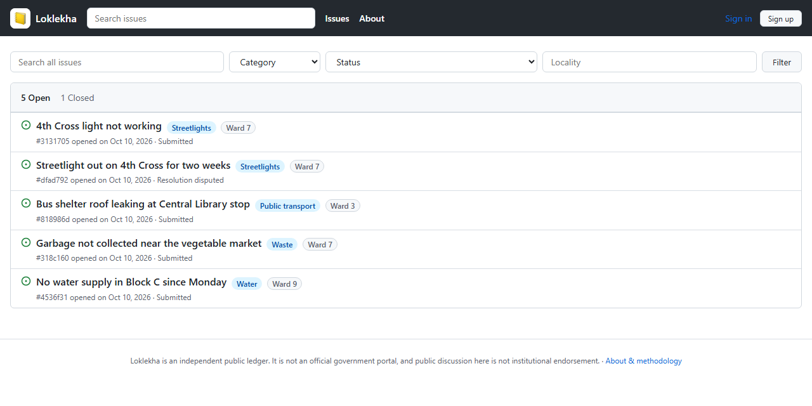
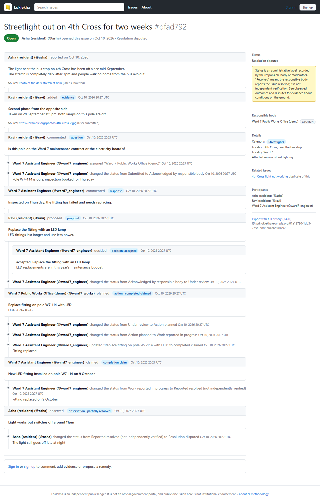
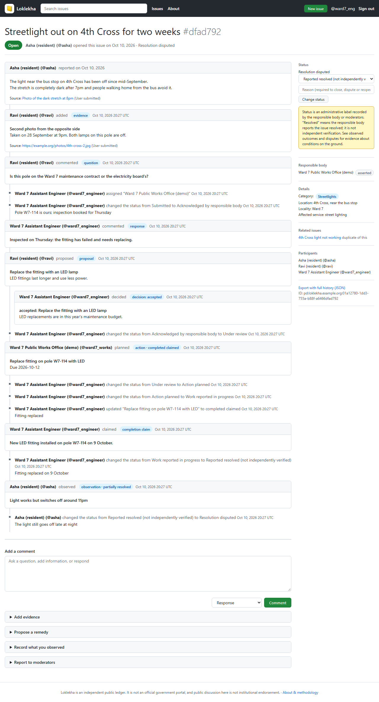
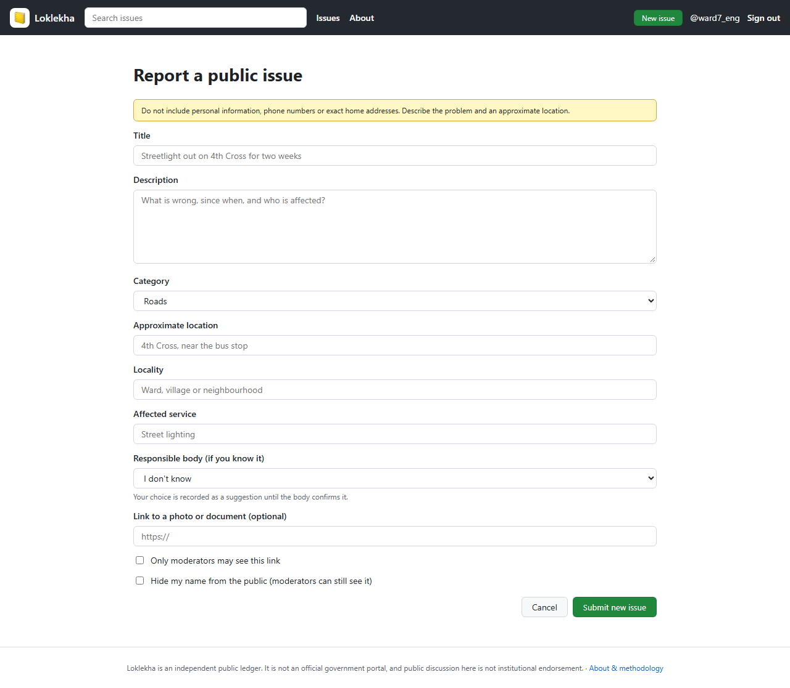
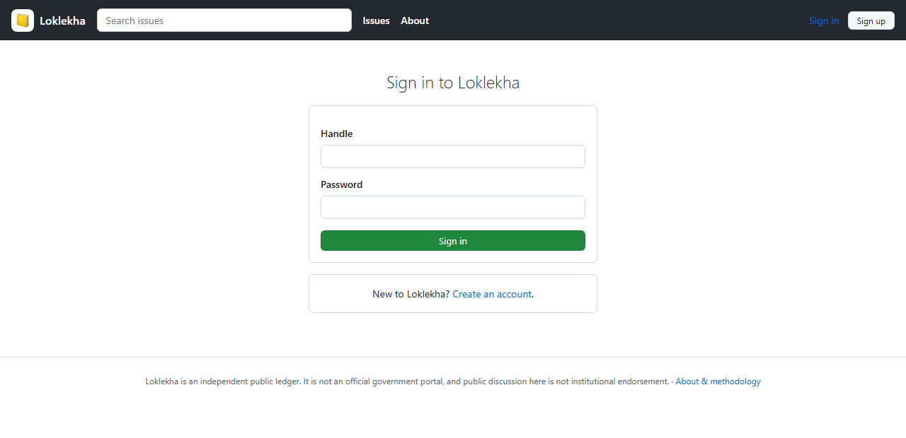
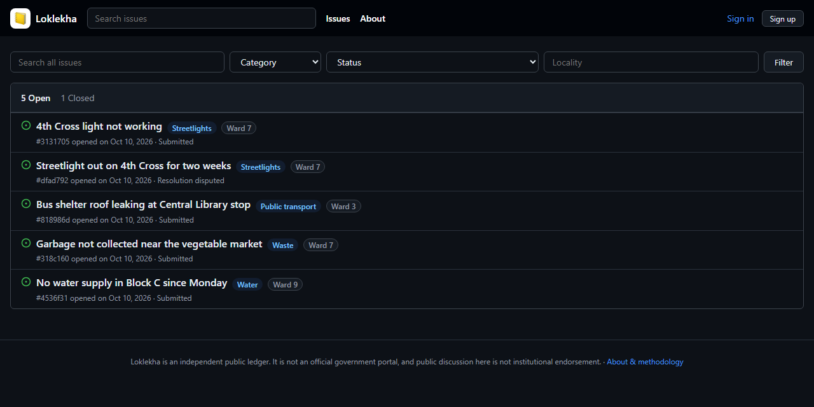

# Loklekha screenshots

A tour of the web UI with sample data, demo accounts and demo institutions.
Back to the [README](../README.md).

## Issues

Open and closed tabs, search and filters.

## An issue's history

The report, evidence, discussion, a proposal and the
institution's decision, the action taken, the completion claim, a resident's
observation and the dispute, each attributed and dated. The sidebar keeps the
reminder that "resolved" is not independent verification.

## Signed in as a responder

The status menu lists only the moves this
person may make, with forms to comment, add evidence, propose a remedy,
record an observation or report to moderators.

## Reporting an issue and signing in

<table>
  <tr>
    <td></td>
    <td></td>
  </tr>
  <tr>
    <td align="center">Reporting an issue</td>
    <td align="center">Sign in</td>
  </tr>
</table>

## Dark mode

The theme follows the system setting.

